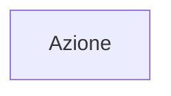
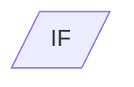
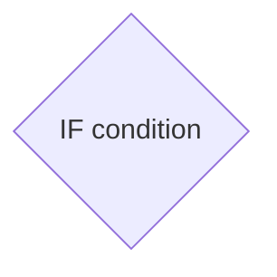
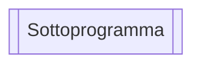
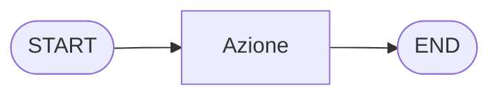

# Simboli principali degli schemi di flusso

Tutti gli schemi di flusso iniziano con **Start** e finiscono con **End** generalmente ovali con testo all'interno.

Uno spazio per eseguire le **operazione di assegnazione e di dichiarazione delle variabili** Forma generalmente rettangolare.

Abbiamo blocchi di **Input e di Output** che servono per avere dei valori inseriti dall'utente e per dare dell'testo o dei risultati in output forma generalmente di parallelogramma.

Poi abbiamo le  **Condizioni** che servono per eseguire una scelta tra un operazione usando gli operatori forma generalmente di rombo con in entrata una freccia  e in uscita due frecce una per il vero e una per il falsa.

Poi un Programma che richiama dei **sottoprogrammi** forma rettangolare con dei bordi laterale oppure rombi con bordi su tutto il contorno per le condizioni

Inoltre troviamo per collegare le varie forme geometriche delle **linee di flusso**:

