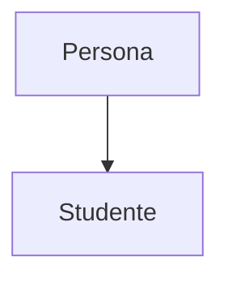
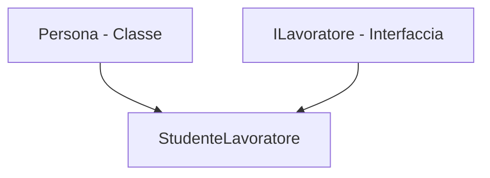

# Classi astratte

> [!tip]
> Cosa sono le classi astratte? Vado a definire una "struttura base" con metodi e proprietà che dovranno poi essere obbligatoriamente implementati nella sottoclasse.

Possono essere **ibride**: quindi possono avere alcuni metodi già implementati e altri astratti.
Nelle classi astratte **pure**, invece, tutti i metodi sono astratti e nessuno di essi contiene codice (nessuna implementazione).

C# utilizza moltissimo anche le **interfacce**. Cosa sono? Vanno a definire tipi e metodi senza implementarli. Sono fondamentali perché permettono a C# di implementare l'**ereditarietà multipla** (che altrimenti con le classi normali o astratte non è permessa).

## Ereditarietà

L'ereditarietà avviene tra una **superclasse** (una classe generale) e una sua **sottoclasse** (ovvero un suo sottoinsieme). Per esempio:

> Ponendo come superclasse **Persona** e come sottoclasse **Studente**, è facile capirne il perché: "studente" è un sottoinsieme di "persona". Avrà dei campi in comune tipo:
> * Nome
> * Cognome
> 
> 
> Ma integrerà comunque altri campi specifici come la matricola o la classe. Quindi lo studente **eredita** i campi dalla superclasse persona e li integra con i suoi campi.



### Ereditarietà multipla

Posso avere delle sottoclassi che ereditano da più fonti.
*Nota per C#: non posso ereditare da più di una classe, ma posso ereditare da una classe ed estendere infinite interfacce.*



## Esempio codice

Questo è un esempio di classe astratta ibrida siccome andiamo a implementare direttamente i campi `_nome` e `_nLati`. Per renderla "pura" (molto simile a un'interfaccia), non dovremmo avere campi privati, ma solo dichiarazioni come:

```csharp
public string Nome { get; set; }
public int NLati { get; set; }

```

#### Classe astratta

```csharp
namespace ClassiAstratte
{
    internal abstract class Figure
    {
        protected string _nome;
        protected int _nLati;

        public string Nome { get => _nome; set => _nome = value; }
        public int NLati { get => _nLati; set => _nLati = value; }

        protected Figure(string nome, int nLati) 
        { 
            this._nLati = nLati;
            this._nome = nome;
        }

        public abstract double Perimetro();
        public abstract double Area();
        public abstract void Disegna(Panel p);
    }
}

```

#### Sottoclasse della classe astratta

```csharp
namespace ClassiAstratte
{
    internal class Quadrato : Figure
    {
        private double _lato;

        // "base" richiama il costruttore della superclasse Figure passando i valori
        public Quadrato(double lato) : base("Quadrato", 4) 
        {
            _lato = lato;
        }

        public override void Disegna(Panel p)
        {
            throw new NotImplementedException();
        }
        
        public override double Area()
        {
            return this._lato * this._lato;
        }
        
        public override double Perimetro()
        {
            return this._lato * NLati;
        }
    }
}

```