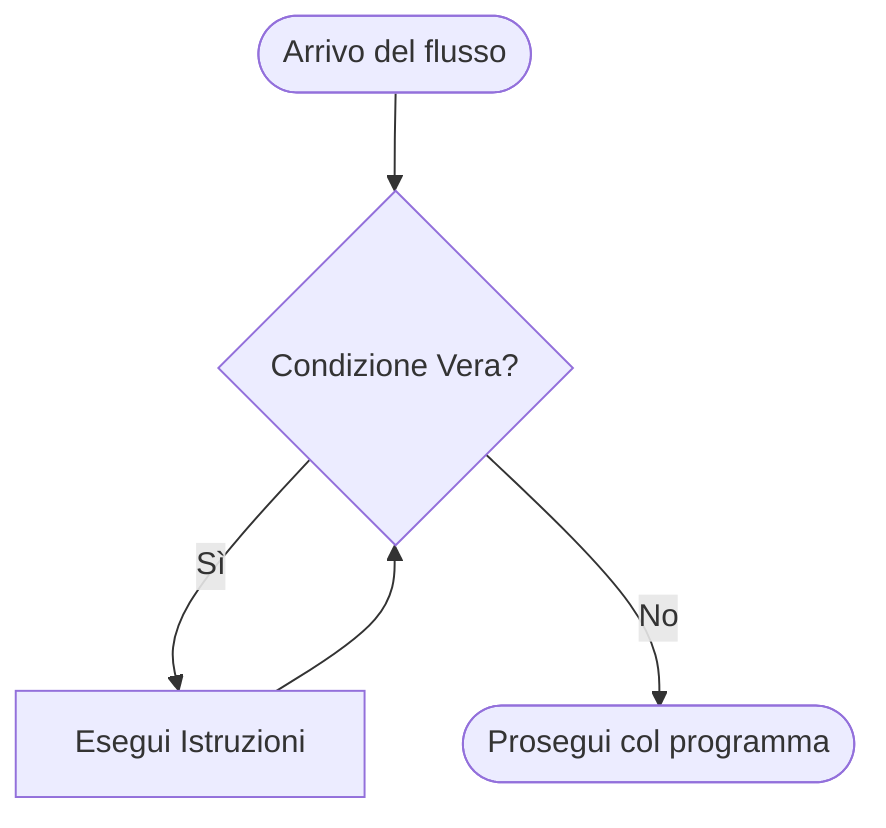
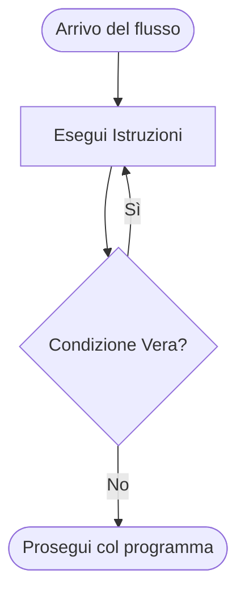
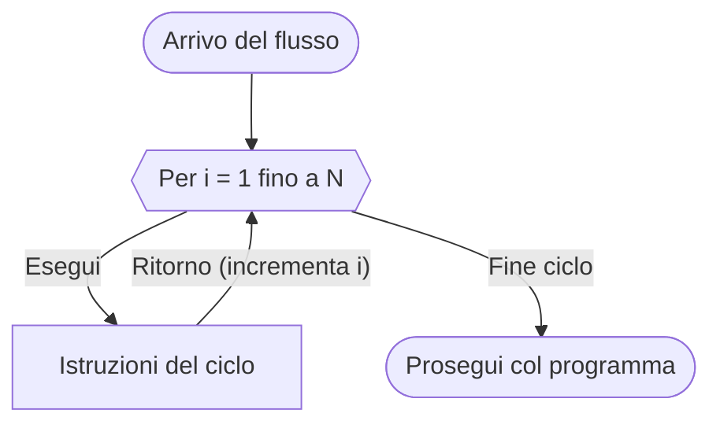

# Cicli schemi di flusso

Possiamo ritrovare diversi tipi di cicli per esempio come detto negli schemi fondamentali troviamo quelli di **Iterazione** ovvero che fanno usi di cicli:
- Precondizionale: La condizione potrebbe non essere mai eseguita
- Post condizionale: La condizione almeno una volta viene eseguita
- Ciclo For: Lo usiamo solo quando sappiamo il numero esatto di volte che il ciclo deve ripetersi

## Ciclo Pre-condizionale

## Ciclo Post-condizionale

## Ciclo for
