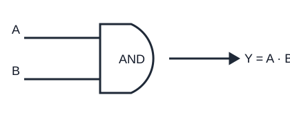

# Porta logica AND

La porta **AND** produce `1` soltanto quando tutti gli ingressi sono `1`. Con due variabili `A` e `B`, l'uscita si scrive `Y = A · B` oppure `Y = A AND B`.

## Tabella della verità

| A | B | Y = A · B |
|---:|---:|---:|
| 0 | 0 | 0 |
| 0 | 1 | 0 |
| 1 | 0 | 0 |
| 1 | 1 | 1 |

## Schema funzionale

## Interpretazione

Se `A` e `B` rappresentano due condizioni che devono essere entrambe vere, l'uscita vale 1 solo quando tutte e due sono vere. Esempio: una macchina parte se l'interruttore generale è attivo **e** il consenso di sicurezza è presente.

In algebra booleana il prodotto logico è commutativo e associativo: `A·B = B·A` e `(A·B)·C = A·(B·C)`. La porta AND si può realizzare usando NAND e NOT: `A·B = NOT(NAND(A,B))`.
