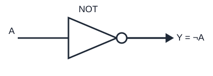

# Porta logica NOT

La porta **NOT** (negazione o invertitore) ha un ingresso e produce il valore logico opposto. Se l'ingresso è `A`, l'uscita si scrive `Y = NOT(A) = ¬A`.

## Tabella della verità

| A | Y = ¬A |
|---:|---:|
| 0 | 1 |
| 1 | 0 |

## Schema funzionale

## Proprietà

- Doppia negazione: `¬(¬A) = A`.
- Complemento: `A + ¬A = 1`.
- Contraddizione: `A · ¬A = 0`.

La NOT si usa anche per costruire altre funzioni logiche. Per esempio, la porta NAND è la negazione dell'AND: `NAND(A,B) = ¬(A·B)`. In uno schema elettronico il pallino sul terminale indica convenzionalmente una negazione/uscita attiva bassa, ma la polarità concreta va letta nel simbolo del componente.
