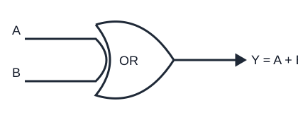

# Porta logica OR

La porta **OR** produce `1` quando almeno uno degli ingressi è `1`. Per due ingressi `A` e `B`, la funzione si scrive `Y = A + B` oppure `Y = A OR B`. Il simbolo `+` in questo contesto indica somma logica, non somma aritmetica.

## Tabella della verità

| A | B | Y = A + B |
|---:|---:|---:|
| 0 | 0 | 0 |
| 0 | 1 | 1 |
| 1 | 0 | 1 |
| 1 | 1 | 1 |

## Schema funzionale

## Interpretazione

Quando l'uscita deve attivarsi se è vera almeno una tra più condizioni, si usa una OR. Esempio: un allarme si attiva se scatta il sensore della porta **oppure** quello della finestra.

La OR è commutativa e associativa. La negazione di una OR è descritta dalla legge di De Morgan: `NOT(A + B) = NOT(A) · NOT(B)`.
