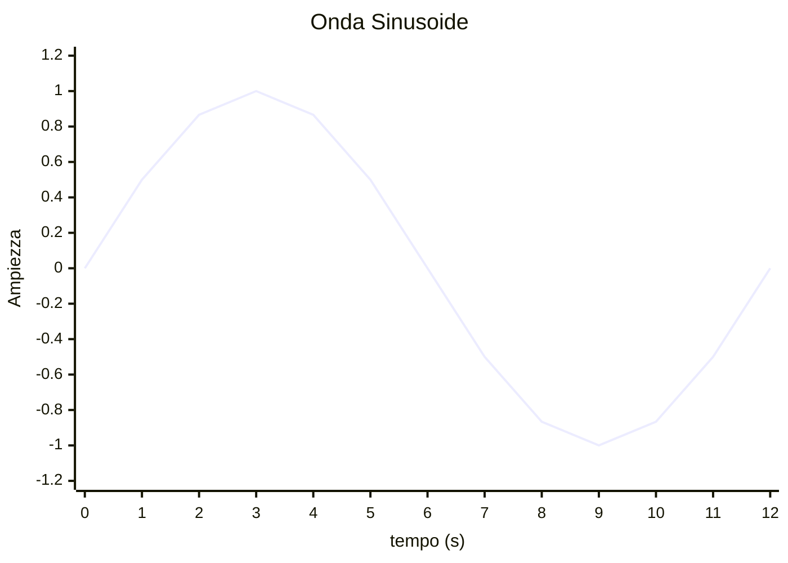

Il perioso è un intervallo di tempo nella quale l'onda si ripete q

$$
e(t)=E_{max}*sin{(\omega t+ \phi)} \\
\omega t = \text{Pulsazione} \\
\phi = \text{Fase iniziale} \\
E_{max} = \text{Ampiezza valore assoluto}
$$

$$
\phi=\frac{1}{T} \\
\omega = 2\pi\phi=\frac{2\pi}{T} \\
\phi = \frac{\Delta t*2\pi}{T} \\
\Delta t : \phi = T : 2\pi
$$

![[GrafiCorrenteAlternata]]
