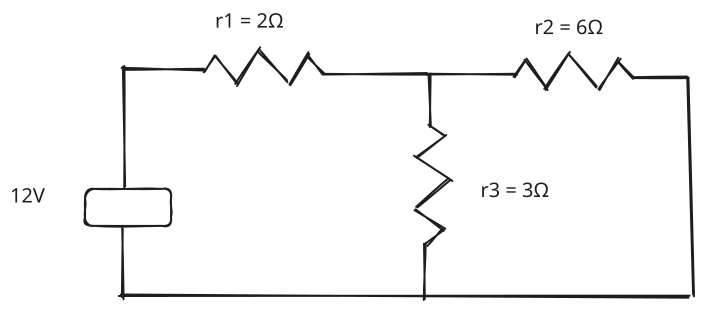
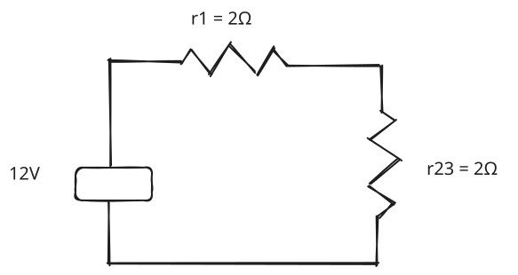
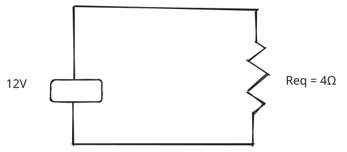

# Semplificazione dei circuiti misti

Un circuito misto contiene sia resistori in serie sia resistori in parallelo. Per risolverlo bisogna trovare la resistenza equivalente e poi ricavare correnti tensioni e potenze.

Il metodo è questo:
1. Individuare i gruppi di resistori che puoi semplificare immediatamente
2. Sostituire ogni gruppo con la sua resistenza equivalente
3. Ripetere sino a che rimane un solo resisotre equivalente
4. Calcoare la corrente totale.
5. Tronare al circuito iniziale per calcolare le correnti e le tensioni dei singoli resistori.

### Esempio

Un generatore idale da 12V alimenta $R_1=2Ω$ in serie a due resistori in parallelo $R_2=6Ω \ e \ R_3=3Ω$

Schema iniziale:

**Passaggio 1 calcolare il parallelo**
$R_2\ e \ R_3$ sono collegati agli stessi due nodi quindi sono in parallelo.

$$  
R_{23}=\frac{R_2R_3}{R_2+R_3} \ \ \ \ \ \ \
R_{23}=\frac{6\cdot3}{6+3}
=\boxed{2\,\Omega}
$$

**Passaggio 2 calcolare la resistenza totale**

$R_1$ è in serie al parallelo equivalente
$$
R_{eq}=R_1+R_{23} \ \ \ \ \ \ R_{eq}=2+2=4\Omega
$$

**Passaggio 3 calcolare la corrente totale**

Applicare la legge di ohm all'intero circuito:

$$
I_{tot}=\frac{V}{R_eq}=\frac{12}4=3A
$$

Questa corrente attraversa $R_1$ siccome è in serie al resto del circuito

**Passaggio 4 calcolare le tensioni**
Ai capi di $R_1$:

$$
V_1=r_1*I_{tot}=2*3=6V
$$

La tensione sul parallelo è:

$$
V_{23}=12-6=6V
$$

Poichè $R_2$ e $R_3$ sono in parallelo:

$$
V_2=V_3=6V
$$

**Passaggio 5 calcolare le correnti dei rami**
Per $R_2$:

$$
I_2=\frac66=1A
$$

Per $R_3$:

$$
I_3=\frac63=2A
$$

Verifica con legge di kirchoof delle correnti:

$$
I_{tot}=I_2+I_3=1+2=3A
$$

**Passaggio 6 calcolare le potenze**

$$
P_1=R_1*I_1^2=2*3^2=18W \\
P_2=R_2*I_2^2=6*1^2=6W\\
P_3=R_3*I_3^2=3*2^2=12W
$$

La potenza erogata dal generatore è:

$$
P_G =V*I_{tot}=21*3=36W
$$

Verifica:

$$
P_1+P_2+P_3=18+6+12=36W
$$
