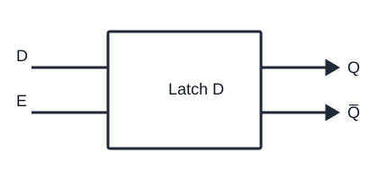

# Latch D

| d   | e   | Q(i)   |
| --- | --- | ------ |
| x   | 0   | Q(i-1) |
| 0   | 1   | 0      |
| 1   | 0   | 1      |
| 1   | 1   | 1      |

e = enable
d = data

Risolve il problema del latch str siccome quando avevamo 0  0 dava errore qui lascia il memoria il resto
