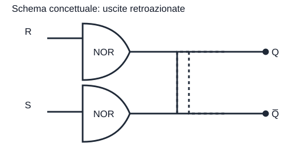

# Latch sr NOR

| S   | R   | Q(i+1) |
| --- | --- | ------ |
| 0   | 0   | Q(i)   |
| 0   | 1   | 0      |
| 1   | 0   | 1      |
| 1   | 1   | N.C    |

Stati:
- MEMORIA 0 0
- RESET 0 1
- SET 1 0
